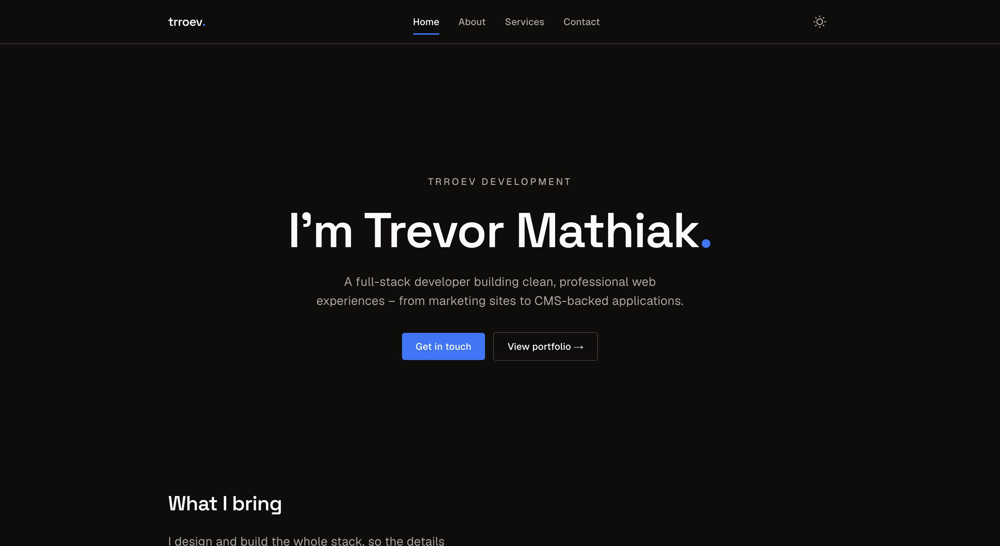

# portfolio

The website for **trroev development** — Trevor Mathiak's personal developer brand.

**Check it out:** [trevormathiak.dev](https://trevormathiak.dev)



## Stack

- [Astro 7](https://astro.build/), statically generated, with [React 19](https://react.dev/) islands for the header and the contact form
- [Tailwind CSS 4](https://tailwindcss.com/)
- [Resend](https://resend.com) for the contact form, behind one on-demand route (`/contact/send`)
- [Biome](https://biomejs.dev/) via [Ultracite](https://www.ultracite.ai/) for linting, [Prettier](https://prettier.io/) for formatting
- [pnpm](https://pnpm.io/) package manager
- Deployed on [Vercel](https://vercel.com/)

## Getting started

```sh
# clone this repo
git clone https://github.com/trroev/portfolio.git
# change into the directory
cd portfolio
# install dependencies
pnpm install
# set up environment variables (see below), then start the dev server
pnpm dev
```

The site runs at [http://localhost:4321](http://localhost:4321).

## Environment variables

Only the contact form needs environment variables. Create a `.env` file in the
project root with the following. Values are also read from Vercel in
preview/production — pull them locally with `vercel env pull`.

| Variable           | Required | Description                                                                        |
| ------------------ | -------- | ---------------------------------------------------------------------------------- |
| `RESEND_API_KEY`   | yes      | [Resend](https://resend.com) API key used by the contact form to deliver messages. |
| `CONTACT_TO_EMAIL` | yes      | Inbox that contact-form submissions are delivered to.                              |

```sh
# .env
RESEND_API_KEY=re_xxxxxxxx
CONTACT_TO_EMAIL=you@example.com
```

The contact form sends from `contact@trevormathiak.dev`; that domain must be
verified in Resend for delivery to succeed.

## Content

All content lives in the repository; changing it is a commit and a deploy (see
[ADR 0004](docs/adr/0004-static-astro-content-in-repo.md)).

- **Pages** — one route file per page in `src/pages`, composed from the block
  components in `src/components/blocks` (`hero`, `page-intro`, `feature-list`,
  `project-showcase`, `story`, `cta-band`, `contact-form`). Each page sets its own
  SEO title and description, falling back to the defaults in `src/config/site.ts`.
- **Projects** — one YAML file per project in `src/content/projects`, next to its
  screenshot, validated by the schema in `src/content.config.ts`. `order` sets the
  curated order.
- **Technologies** — `src/content/technologies.json`; project `tech` entries must
  match a name here or the build fails.
- **Site chrome** — header nav, footer links and social links in
  `src/config/site-chrome.ts`, typed against the known pages in
  `src/config/pages.ts`.

## Scripts

| Command          | Description                                       |
| ---------------- | ------------------------------------------------- |
| `pnpm dev`       | Start the development server                      |
| `pnpm build`     | Build for production (`astro build`)              |
| `pnpm lint`      | Lint with Biome (Ultracite preset, formatter off) |
| `pnpm format`    | Format every file with Prettier                   |
| `pnpm typecheck` | Type-check with `astro check`                     |
